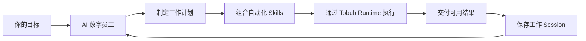

  

<h1 align="center">Tobub：面向 AI Agent 的浏览器自动化桌面应用</h1>

<strong>让 AI Agent 操作本机浏览器、执行网站任务，并保存结果供复查。</strong>

  <a href="https://tobub.com">官网</a> ·
  <a href="https://github.com/pow505/tobub/releases/latest">下载 Tobub</a> ·
  <a href="./demos/">Skill 示例</a> ·
  <a href="readme.md">English</a>

## Tobub 是什么？

Tobub 是一款浏览器自动化桌面应用，可让 AI Agent 操作本机浏览器执行网站任务。你可以手动运行 Skill，也可以让 Agent 根据目标选择 Skill；Tobub 会将每次执行和结果保存到 Session（工作记录）中，方便复查或继续处理。

Skill 是一份可重复运行的自动化流程定义，用来完成一类网站任务，例如采集 Reddit 新帖子或 YouTube 评论。

本仓库提供这些 Skill 的 JSON 定义和示例、分别供 Claude Code 和本地 Codex 使用的 Agent Skill 包、WorkBuddy Connector，以及 DeepSeek Harness 插件。桌面应用不包含在仓库中；运行这些 Skill 需要另外安装 Tobub。

## 产品演示

## 为什么用 Tobub 做浏览器自动化？

| | 说明 |
| --- | --- |
| **AI 数字员工** | 拥有专业角色并能制定计划、协调 Skills、持续推进多步骤任务的 AI Agent。 |
| **自动化 Skills** | 以 JSON 定义、可复用的工作流，连接 Agent 与受支持的平台和工具，完成研究、分析和操作。 |
| **工作 Session** | 持续记录计划、来源、进度、结果和上下文，便于复查与后续跟进。 |

## 自动化 Skill 如何工作？

Skill 是一份保存好的自动化流程，告诉 Tobub 如何在受支持的网站上完成任务，例如采集 Reddit 帖子或 YouTube 评论。典型流程分为四步：

1. **Collect / 收集**：从受支持的网站和服务获取信息。
2. **Organize / 整理**：将结果归纳为结构化、可复用的工作材料。
3. **Analyze / 分析**：识别趋势，研究客户、竞品和市场信号。
4. **Execute / 执行**：完成请求的下一步操作，并返回清晰结果。

Skills 可以组合使用。例如，研究分析师可以把搜索、网页抓取、RSS、GitHub 和社区 Skills 串成可重复运行的市场情报工作流。

## AI 数字员工角色

Tobub 当前展示的数字员工角色包括：

- 运营专家
- 数据工程师
- 研究分析师
- 内容策略师
- 社交媒体经理
- 市场情报分析师
- SEO 专家
- 客户洞察分析师
- 产品分析师
- 新闻编辑
- 销售研究员
- 知识策展人

每个角色都把专业工作方法转化为可复用的工作流。Agent 负责协调 Skills、保留上下文、跟踪进度，并留下便于复查和继续推进的成果。

## 当前自动化 Skill 能力库

- **研究类**：Google Search、Web Crawler、RSS & Feeds、Reddit
- **社交情报类**：YouTube、Facebook、TikTok、Instagram、X / Twitter
- **商业与市场类**：LinkedIn、Shopify / Amazon
- **开发者情报类**：GitHub

可将这些 Skills 用于市场研究、趋势发现、社交监听、客户洞察、竞品监控、新闻监测、SEO 研究和结构化网页提取。

## 典型工作流

1. 给 Tobub 一个明确目标。
2. 数字员工确认目标并生成分步骤的工作计划。
3. Agent 选择任务所需的 Skills。
4. Skills 通过 Tobub Runtime 访问支持的平台并执行。
5. Tobub 在 Session 中展示进度、来源、依据和中间结果。
6. Agent 交付结果，并保存可继续使用的 Session。

## 在 AI 平台中使用 Tobub

各平台集成都连接本机 Tobub 桌面应用。请启动 Tobub，并按对应平台的指南安装和使用：

- [Claude Code 使用指南](./platforms/claude-code/README.md)：Agent Skill + MCP。
- [Codex 使用指南](./platforms/codex/README.md)：Agent Skill + MCP。
- [DeepSeek Harness 使用指南](./platforms/deepseek-harness/README.md)：原生插件。
- [WorkBuddy 使用指南](./platforms/workbuddy/README.md)：Connector。

## 开源 Tobub Skills，Runtime 单独发布

本仓库开放 Tobub 的 **Skill 能力层**：以 JSON 定义、可由兼容 Tobub 的软件安装和执行的自动化工作流。Skill 可以复用和审阅，但不是独立的浏览器自动化应用。

Tobub 桌面应用和 Runtime 实现属于单独发布的闭源产品。仅克隆本仓库无法获得应用、平台适配器、认证、账号管理或完整执行环境。

| 本仓库开放 | 不包含在本仓库 |
| --- | --- |
| 原生 JSON Skill 定义 | Tobub 桌面应用 |
| Skill 文档与示例 | Tobub Runtime 实现 |
| Claude Code、Codex Agent Skill、WorkBuddy Connector 和 DeepSeek Harness 插件源文件 | 平台适配器与认证系统 |
| 社区评审与改进 | 安装包及商业发行代码 |

这样的分工让社区能够审阅和扩展自动化工作流，同时由 Tobub 提供本地执行环境和完整产品体验。

## 如何在 Tobub 中运行 Skill？

1. 下载 Windows、macOS 或 Linux 版 Tobub。
2. 在 Tobub 中导入或安装本仓库的 Skill。
3. 配置 Skill 所需的平台账号和运行时资源。
4. 手动运行 Skill，或让数字员工自动选择它。
5. 在 Session 中查看执行过程和结果。

Tobub 应用还支持 Docker / 自部署、本地数据控制与 OpenAPI 集成。这些产品能力由单独发布的应用和 Runtime 提供。

## 如何贡献 Skill？

每个 Skill 贡献都应清晰、便于评审，并能安全复用：

- 说明它解决的问题和改善的工作流；
- 写清平台、输入、输出、副作用和所需权限；
- 提供 JSON 定义和真实使用示例；
- 说明速率限制、平台限制和失败处理；
- 在兼容的 Tobub 软件中测试后再提交 Pull Request；
- 不要提交密码、Cookie、Token、个人数据或未经授权的内容。

## 安全与平台合规

Skills 会与第三方平台交互，必须遵守平台条款、API 限制、隐私要求、robots 规则和当地法律。测试时请使用测试账号和最小权限。当认证、输入或平台状态不确定时，Skill 应安全失败。

## 产品入口

- [下载 Tobub](https://github.com/pow505/tobub/releases/latest)
- [Tobub 官网](https://tobub.com)
- [English README](readme.md)
- MIT
桌面应用与本开放 Skill 仓库分开发布。
